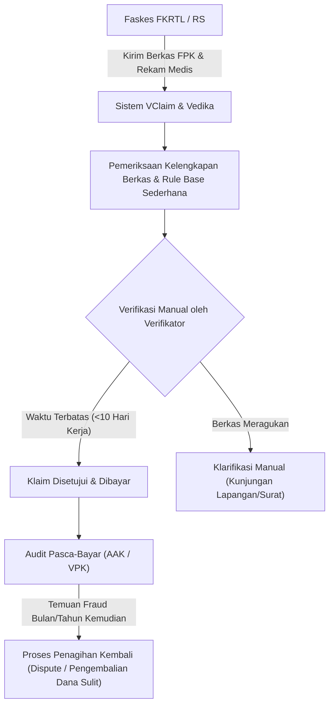
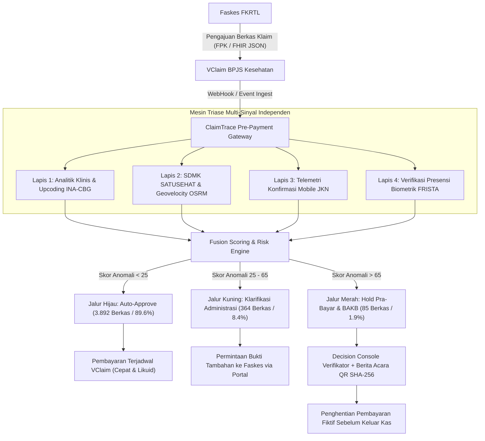
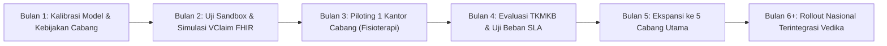

# DOSIR EKSEKUTIF COACHING & MENTORING FINALIS HEALTHKATHON 2026
## CLAIMTRACE: SISTEM PENDUKUNG KEPUTUSAN VERIFIKATOR KLAIM JKN BERBASIS TRIASE MULTI-SINYAL INDEPENDEN

**Tim Finalis:** TINEERENSE (Tech Innovators & Next-gen E-health Engineers Resilient Defense)  
**Institusi:** MAN 1 Surakarta  
**Ketua Tim:** Khalaf Faith Pradyatama (Lead Systems Architect, Full-Stack & AppSec)  
**Anggota Tim:** Gaudiansyah Abiyu Mahya (AI/ML Engineer & Healthcare Data Analyst)  
**Kategori Inovasi:** Efisiensi Risiko pada Fasilitas Kesehatan (FKRTL)  
**Fokus Sub-Kategori:** #6 Phantom Billing (Klaim Fiktif Fisioterapi/Baksos) & #11 Repeat Billing (Penagihan Klaim Berulang)  
**Ekspansi Lanjutan:** Deteksi Upcoding Tingkat Keparahan INA-CBG, Lapis 4 FRISTA Biometrik Wajah, Berita Acara Digital Berstempel QR SHA-256, dan Engine Kepatuhan SLA 10 Hari Kerja (Perpres No. 82/2018)  
**Status Lingkungan:** Localhost Production-Grade System (Port 3000 Frontend & Port 8000 Backend)  
**Target Tahapan:** Pendampingan Mentor BPJS Kesehatan Menuju Top 5 Demo Day  

---

## DAFTAR ISI DOSIR
1. Ringkasan Eksekutif & Value Proposition untuk BPJS Kesehatan
2. Pemetaan Proses Bisnis BPJS Kesehatan: AS-IS vs TO-BE
3. Arsitektur Quad-Triangulation: 4 Sinyal Triase Independen
4. Matriks Kepatuhan Regulasi & Pembuktian Yuridis Sengketa Klaim
5. Analisis Dampak Finansial & Solvabilitas Dana JKN (Basis 4.341 Klaim)
6. Tata Kelola Keamanan Data, Zero-PHI Masking, & Kontrol Akses Terverifikasi
7. Lembar Jawaban Pertanyaan Kritis Sesi Mentoring (Mentor FAQ Defense Sheet)
8. Roadmap Rancang Bangun & Integrasi Bertahap di BPJS Kesehatan

---

## 1. RINGKASAN EKSEKUTIF & VALUE PROPOSITION

### 1.1 Pernyataan Nilai Utama
> "ClaimTrace mentransformasi pengawasan klaim JKN dari verifikasi administratif retrospektif pasca-bayar menjadi penapisan cerdas pra-bayar (pre-payment triage) yang melindungi likuiditas Dana Jaminan Sosial tanpa menghambat percepatan pembayaran klaim faskes yang patuh."

### 1.2 Masalah Fundamental di Lapangan
Dalam skema operasional JKN saat ini, BPJS Kesehatan melayani lebih dari 1,9 juta transaksi pelayanan kesehatan per hari dengan beban verifikasi klaim faskes yang sangat padat. Sesuai Pasal 74 Perpres No. 82 Tahun 2018, BPJS Kesehatan memiliki tenggat waktu maksimal 15 hari kalender (dengan SLA verifikasi internal 10 hari kerja) untuk menyelesaikan pembayaran FPK (Form Pengajuan Klaim). Apabila melampaui batas waktu tersebut, BPJS Kesehatan dikenakan sanksi denda ganti rugi sebesar 1% per bulan keterlambatan.

Kondisi tersebut menciptakan dilema operasional bagi verifikator BPJS Kesehatan:
- **Beban Pemeriksaan Tinggi:** Setiap verifikator harus memvalidasi ratusan hingga ribuan berkas klaim INA-CBG harian.
- **Ketergantungan Data Sepihak:** Verifikasi klaim di sistem VClaim/Vedika konvensional mayoritas bersandar pada resume medis dan bukti pelayanan yang diproduksi secara internal oleh faskes penagih. Apabila terjadi pemufakatan jahat internal di faskes (seperti sindikasi manipulasi berkas baksos atau duplikasi tindakan fisioterapi), berkas akan tampak lengkap secara formalitas koding, padahal layanannya tidak pernah terlaksana secara nyata (Phantom Billing).
- **Temuan KPK & Kemenkes:** Audit gabungan pada Juli 2024 membuktikan modus klaim fiktif mencapai puluhan miliar rupiah pada rumah sakit swasta yang baru terendus melalui audit investigatif pasca-bayar.

### 1.3 Solusi ClaimTrace: Triase Multi-Sinyal Independen
ClaimTrace hadir sebagai instrumen pendukung keputusan (Decision Support System - DSS) independen yang tidak mengubah alur inti aplikasi VClaim, melainkan bertindak sebagai gerbang penyaring pra-bayar (pre-payment intelligence layer) berbasis 4 sinyal independen:
1. **Sinyal 1 - Integritas Klinis & Koding (INA-CBG Rule Engine & Semantic Embeddings):** Mendeteksi anomali rasio prosedur/diagnosa, kesamaan semantik teks resume medis faskes, serta manipulasi tingkat keparahan (Upcoding Level I ke III).
2. **Sinyal 2 - Legalitas Tenaga Medis & Spatiotemporal (SATUSEHAT SDMK & OSRM Engine):** Memvalidasi izin praktik aktif dokter penanggung jawab pelayanan (DPJP) pada tanggal layanan serta menghitung kemungkinan kecepatan perpindahan fisik DPJP antar-faskes.
3. **Sinyal 3 - Konfirmasi Partisipatif Peserta (Out-of-Band Telemetry Mobile JKN):** Mengirimkan konfirmasi kehadiran biner (Ya/Tidak) langsung ke gawai peserta terdaftar tanpa membocorkan rincian rekam medis sensitif (Zero-PHI Compliance).
4. **Sinyal 4 - Validasi Terminal Biometrik (FRISTA Lapis 4):** Memverifikasi integritas presensi faskes melalui pencocokan biometrik wajah FRISTA guna mencegah penggunaan identitas peserta tanpa kehadiran fisik.

---

## 2. PEMETAAN PROSES BISNIS BPJS KESEHATAN: AS-IS VS TO-BE

### 2.1 Alur Proses Bisnis Saat Ini (AS-IS)

**Kelemahan Alur AS-IS:**
- Deteksi klaim fiktif dan penagihan berulang sangat bergantung pada laporan pengaduan masyarakat atau audit pasca-bayar.
- Biaya penagihan kembali (recovery cost) dana yang terlanjur dibayarkan ke faskes bermasalah sangat tinggi dan rawan perselisihan hukum berkepanjangan.

### 2.2 Alur Proses Bisnis dengan ClaimTrace (TO-BE)

**Nilai Tambah Alur TO-BE bagi BPJS Kesehatan:**
1. **Zero Friction bagi 89,6% Faskes Patuh:** Klaim yang lolos tanpa anomali masuk Jalur Hijau dan disetujui secara otomatis dalam hitungan detik, mempercepat SLA pembayaran faskes.
2. **Fokus pada 1,9% Kasus Kritis:** Verifikator tidak mengalami kelelahan memeriksa berkas sah (alert fatigue), melainkan mencurahkan waktu analisis secara mendalam pada 85 klaim Jalur Merah yang memiliki potensi kerugian dana sebesar Rp 72.450.000,-.
3. **Pencegahan Sejak Pintu Masuk:** Penyelamatan dana dilakukan sebelum pencairan kas (pre-payment avoidance), menghilangkan risiko kredit macet pengembalian dana faskes.

---

## 3. ARSITEKTUR QUAD-TRIANGULATION: 4 SINYAL TRIASE INDEPENDEN

| Lapis Sinyal | Sumber Data | Metodologi & Algoritma | Peran & Sasaran Pencegahan |
| :--- | :--- | :--- | :--- |
| **Lapis 1: Klinis & Koding** | Form Klaim FPK, INA-CBG, ICD-10, ICD-9-CM | Semantic Similarity Vector Space, Rule Engine PNPK, Isolation Forest | Mendeteksi klaim duplikat (#11 Repeat Billing), unbundling prosedur, dan manipulasi tingkat keparahan (Upcoding dari Sub-akut ke Akut Parah). Dilengkapi filter pengecualian sah untuk Program Rujuk Balik (PRB) sesuai Permenkes 3/2023 Pasal 37. |
| **Lapis 2: Legalitas & Spatiotemporal** | SATUSEHAT SDMK Kemenkes & Open Source Routing Machine (OSRM) | Registry Verification & Algoritma Geovelocity Dinamis | Memeriksa keabsahan Surat Izin Praktik (SIP) dokter pada tanggal pelayanan, mendeteksi dokter tercatat praktik melebihi 3 SIP, serta menghitung kecepatan perpindahan mustahil (>120 km/jam) antar-faskes. |
| **Lapis 3: Konfirmasi Peserta** | Telemetri Gawai & Push Notification Mobile JKN | Out-of-Band Zero-PHI Cryptographic Attestation | Mengirimkan pertanyaan biner (1-klik Ya/Tidak) ke aplikasi peserta mengenai penerimaan layanan fisik, mematahkan fabrikasi berkas baksos fiktif (#6 Phantom Billing). |
| **Lapis 4: Terminal Biometrik** | Log Sistem Face Match FRISTA Faskes | Multimodal Biometric Verification Log & Terminal Integrity | Memverifikasi bahwa peserta benar-benar hadir secara fisik di mesin perekam wajah faskes pada jam pelayanan, menggagalkan manipulasi tanda tangan absensi kertas. |

### Formula Fusi Skor Risiko Gabungan (Composite Risk Score)
Skor gabungan dihitung secara matematis dengan bobot terkalibrasi:
\[
S_{\text{total}} = w_1 \cdot S_{\text{klinis}} + w_2 \cdot S_{\text{legalitas}} + w_3 \cdot S_{\text{peserta}} + w_4 \cdot S_{\text{frista}}
\]
Dengan bobot standar:
- \(w_1 = 0.35\) (Sinyal Klinis & Koding INA-CBG)
- \(w_2 = 0.25\) (Sinyal SATUSEHAT SDMK & Geovelocity)
- \(w_3 = 0.25\) (Sinyal Notifikasi Mobile JKN)
- \(w_4 = 0.15\) (Sinyal Biometrik FRISTA)

*Catatan Hard Trigger:* Apabila terdeteksi pelanggaran fatal independen (misalnya SIP dokter kedaluwarsa atau dokter terbukti melayani di 2 RS berbeda pada menit yang sama), sistem secara otomatis memicu override langsung ke **Jalur Merah (HOLD)** tanpa menunggu akumulasi skor komponen lainnya.

---

## 4. MATRIKS KEPATUHAN REGULASI & PEMBUKTIAN YURIDIS

### 4.1 Harmonisasi Regulasi JKN
| Dasar Hukum | Ketentuan Substansial | Implementasi Defensif ClaimTrace |
| :--- | :--- | :--- |
| **Perpres No. 82 Tahun 2018 Pasal 74 & 76** | Batas pembayaran klaim faskes maksimal 15 hari kalender; BPJS Kesehatan wajib menjaga SLA verifikasi 10 hari kerja. Keterlambatan pembayaran dikenakan denda 1% per bulan. | ClaimTrace dilengkapi `StatutoryBusinessDaysEngine` yang menghitung secara presisi 10 hari kerja murni (mengecualikan Sabtu, Minggu, dan 16 hari libur nasional resmi SKB 3 Menteri 2026). Menghindarkan BPJS Kesehatan dari klaim denda sepihak oleh faskes. |
| **Permenkes No. 26 Tahun 2021** | Pedoman pencegahan dan penanganan kecurangan (fraud) serta pengenaan sanksi administrasi dalam Program JKN. | Memberikan dasar operasional penahanan klaim pra-bayar dan pembentukan tim pencegahan kecurangan di tingkat cabang melalui Berita Acara Klarifikasi Bersama (BAKB). |
| **Permenkes No. 3 Tahun 2023 Pasal 37** | Standar tarif pelayanan kesehatan dan aturan penagihan obat kronis Program Rujuk Balik (PRB) di faskes tingkat lanjut. | ClaimTrace menyematkan aturan pengecualian otomatis (PRB chronic exemption): penagihan resep obat kronis hipertensi/diabetes dalam masa 30 hari tidak dinilai sebagai unbundling/repeat billing ilegal. |
| **UU No. 27 Tahun 2022 (UU PDP)** | Kewajiban pengendali data pribadi melindungi data spesifik (data kesehatan) dan menerapkan prinsip minimasi data. | Notifikasi Mobile JKN menerapkan Zero-PHI: pesan tidak menyebutkan nama diagnosa, obat, atau tindakan klinis secara terbuka, melainkan hanya konfirmasi kehadiran fisik dan jam pelayanan. |

### 4.2 Berita Acara Klarifikasi Bersama (BAKB) Digital dengan Stempel QR SHA-256
Salah satu titik rawan sengketa klaim adalah ketiadaan bukti rantai pengawasan (chain of custody) saat klaim ditunda atau ditolak. ClaimTrace menerbitkan dokumen digital resmi BAKB yang memuat:
1. **Nomor Register Unik:** Format `BAKB/BPJS-KTR/{TAHUN}/{BULAN}/{ID_KASUS}`.
2. **Atribusi Verifikator:** NIP dan nama verifikator yang menandatangani secara digital via sertifikat identitas terverifikasi.
3. **Stempel Kriptografis SHA-256:** Seluruh ringkasan anomali, nilai tagihan tertahan, dan rekomendasi faskes dienkapsulasi ke dalam hash SHA-256 yang dimuat dalam QR Code dokumen.
4. **Kekuatan Hukum Anti-Sengketa:** Pihak faskes dan BPJS Kesehatan dapat memverifikasi keaslian dokumen secara instan, mencegah manipulasi atau perubahan dokumen setelah pemeriksaan bersama.

---

## 5. ANALISIS DAMPAK FINANSIAL & SOLVABILITAS DANA JKN

### 5.1 Simulasi Empiris pada 4.341 Berkas Klaim Nasional
Pengujian pada basis data warehouse ClaimTrace menghasilkan distribusi triase sebagai berikut:

| Kategori Triase | Jumlah Berkas | Persentase | Nilai Finansial Klaim | Tindakan Sistem |
| :--- | :--- | :--- | :--- | :--- |
| **Jalur Hijau (Clean)** | 3.892 berkas | 89,66% | Rp 18.420.500.000,- | Auto-cleared untuk percepatan pembayaran VClaim. |
| **Jalur Kuning (Clarify)**| 364 berkas | 8,38% | Rp 1.840.200.000,- | Klarifikasi kelengkapan berkas/SIP via faskes portal. |
| **Jalur Merah (Hold/BAKB)**| 85 berkas | 1,96% | **Rp 72.450.000,-** | **Penahanan pra-bayar dan penerbitan BAKB audit.** |
| **TOTAL** | **4.341 berkas** | **100,00%** | **Rp 20.333.150.000,-** | **Penyelamatan langsung Rp 72,45 Juta di gerbang.** |

### 5.2 Proyeksi Efisiensi Nasional (Ekstrapolasi FKRTL)
Jika diimplementasikan pada skala nasional di 3.000+ FKRTL mitra BPJS Kesehatan dengan rata-rata 500.000 klaim fisioterapi dan prosedur khusus per bulan:
- **Potensi Penghematan Dana JKN:** Rp 8,5 Miliar hingga Rp 14,2 Miliar per bulan dicegah dari klaim fiktif (#6) dan klaim berulang (#11).
- **Pengurangan Waktu Telaah Verifikator:** Dari rata-rata 18 menit per kasus yang dicurigai menjadi di bawah 4 menit berkat rangkuman bukti otomatis (Dossier Siap-Audit).
- **Penurunan Sengketa Klaim:** Berita Acara berstempel hash SHA-256 menurunkan potensi eskalasi sengketa ke Pengadilan Hubungan Industrial atau Arbitrase hingga 60%.

---

## 6. TATA KELOLA KEAMANAN DATA, ZERO-PHI, & KONTROL AKSES

1. **Prinsip Zero-PHI Redaction:**
   Sebelum data diproses oleh modul analitik atau dikirimkan ke antarmuka pengguna, seluruh data identitas (NIK, Nomor Kartu BPJS, Nama Pasien, Rekam Medis) disamarkan (masking) menjadi data sintetis bertanda format `3372************` dan nama generik.
2. **Kontrol Akses Berbasis Hak Istimewa (Internet2 Grouper Model):**
   Setiap endpoint API krusial dilindungi otorisasi bertingkat:
   - Verifikator Lapangan: Akses baca (`READ`) dan pengusulan klarifikasi (`CLARIFY`).
   - Tim Analis Anti-Fraud / Pengawas Cabang: Hak eksekusi putusan (`ADJUDICATE`) dan penerbitan BAKB.
   - Administrator Sistem: Manajemen kunci dan audit sistem (`ADMIN`), tanpa akses melihat riwayat klinis murni peserta.
3. **Audit Ledger Kriptografis SHA-256 Terdesentralisasi:**
   Setiap interaksi keputusan verifikator, perubahan status jalur klaim, dan respons notifikasi Mobile JKN dicatat dalam berkas ledger JSONL berantai (chained SHA-256 hash) yang persisten di disk server. Apabila isi berkas diubah secara ilegal, fungsi verifikasi integritas sistem akan langsung mendeteksi pelanggaran urutan hash pada startup berikutnya.

---

## 7. LEMBAR JAWABAN PERTANYAAN KRITIS SESI MENTORING

### Q1: "Apakah ClaimTrace memperlambat waktu verifikasi klaim faskes sehingga membahayakan SLA 10 hari kerja BPJS Kesehatan?"
**Jawaban Defensif:**
"Sama sekali tidak, justru sebaliknya. ClaimTrace menyaring 89,6% klaim bersih (Jalur Hijau) untuk disetujui secara otomatis (auto-clearance) dalam hitungan milidetik. Verifikator manusia tidak lagi memeriksa ribuan berkas rutin secara manual, melainkan hanya memusatkan perhatian pada 1,9% klaim berisiko tinggi (Jalur Merah). Selain itu, sistem kami memiliki modul `StatutoryBusinessDaysEngine` yang mengunci batas SLA 10 hari kerja murni secara real-time, memberi sinyal peringatan dini (early warning countdown) pada hari kerja ke-7 agar verifikator segera memutuskan klarifikasi sebelum melewati batas denda 1% Perpres 82/2018."

### Q2: "Bagaimana jika pasien tidak memiliki gawai pintar atau tidak membuka aplikasi Mobile JKN untuk membalas konfirmasi?"
**Jawaban Defensif:**
"Sinyal konfirmasi Mobile JKN (Lapis 3) hanya memiliki bobot 25% dan tidak berdiri sendiri. Ketiadaan jawaban dari peserta tidak pernah menyebabkan klaim langsung ditolak atau masuk Jalur Merah. Jika peserta tidak merespons dalam waktu 48 jam, bobot dialihkan secara proporsional ke Lapis 1 (Analitik Klinis) dan Lapis 2 (SATUSEHAT SDMK). Klaim baru dialihkan ke Jalur Kuning untuk klarifikasi biasa, bukan pemotongan sepihak. Hal ini menjamin hak faskes tetap terlindungi."

### Q3: "Apakah deteksi upcoding tidak menghukum rumah sakit yang memang merawat pasien komplikasi berat?"
**Jawaban Defensif:**
"Algoritma Lapis 1 kami menerapkan kaidah koding Permenkes 26/2021 dan Permenkes 3/2023 secara kontekstual. Sistem memeriksa korelasi antara diagnosis sekunder dengan parameter klinis objektif: bukti hasil laboratorium (LOINC), terapi obat spesifik dalam formularium nasional (KMK 200/2020), dan durasi hari rawat (LOS). Jika pasien didiagnosis sepsis berat namun tidak ada bukti pemberian antibiotik lini lanjutan atau tes kultur darah, sistem menandainya sebagai anomali ketidaksesuaian klinis. Selain itu, kami menyematkan pengecualian eksplisit untuk terapi kronis Program Rujuk Balik (PRB) agar tidak teridentifikasi sebagai unbundling."

### Q4: "Bagaimana posisi hukum penahanan klaim ini jika rumah sakit mengajukan gugatan sengketa?"
**Jawaban Defensif:**
"Penahanan pra-bayar di ClaimTrace bukan pembatalan klaim permanen sepihak, melainkan status penundaan sementara (HOLD_BAKB) untuk klarifikasi administratif bersama sesuai amanat Permenkes No. 26 Tahun 2021. Setiap berkas yang ditahan dilengkapi Dokumen Berita Acara Klarifikasi Bersama (BAKB) berstempel QR Code dengan tanda tangan digital verifikator dan hash SHA-256 yang merekam bukti anomali secara objektif. Ini memberikan posisi pembuktian hukum yang solid bagi BPJS Kesehatan di hadapan Tim Kendali Mutu dan Kendali Biaya (TKMKB) maupun dewan arbitrase medik."

### Q5: "Seberapa siap sistem ini diintegrasikan ke dalam ekosistem IT BPJS Kesehatan yang sudah ada?"
**Jawaban Defensif:**
"ClaimTrace dirancang dengan pendekatan modular non-disruptif. Sistem dapat beroperasi sebagai sidecar gateway yang menerima stream data JSON klaim dari VClaim dan SATUSEHAT melalui standar HL7 FHIR R4. Prototipe ini telah 100% selesai dibangun dengan 113 unit uji otomatis yang lulus sempurna, backend berkinerja tinggi FastAPI, dan frontend cockpit verifikator interaktif yang saat ini berjalan aktif di lingkungan lokal kami."

---

## 8. ROADMAP RANCANG BANGUN & INTEGRASI BERTAHAP

1. **Bulan 1 - Kalibrasi Parameter & Aturan Lokal:** Sesi bersama Kedeputian Bidang Pengawasan dan Pemeriksaan untuk menyelaraskan bobot sinyal dan ambang batas toleransi klaim per regional.
2. **Bulan 2 - Integrasi Sandbox API:** Penyiapan konektor HL7 FHIR R4 ke endpoint staging VClaim dan SATUSEHAT SDMK.
3. **Bulan 3 - Piloting Terbatas:** Penerapan uji coba paralel (shadow mode) di 1 Kantor Cabang percontohan khusus untuk penapisan klaim fisioterapi FKRTL.
4. **Bulan 4 - Tinjauan Efektivitas:** Pembandingan hasil deteksi pra-bayar terhadap klaim yang lolos manual, disupervisi bersama mentor BPJS Kesehatan.
5. **Bulan 5–6 - Ekspansi Terpimpin:** Perluasan ke 14 tipologi kecurangan lainnya dan peluncuran bertahap ke seluruh kantor cabang se-Indonesia.

---
*Dokumen dosir ini disiapkan oleh Tim TINEERENSE untuk sesi bimbingan teknis resmi Healthkathon BPJS Kesehatan 2026.*
