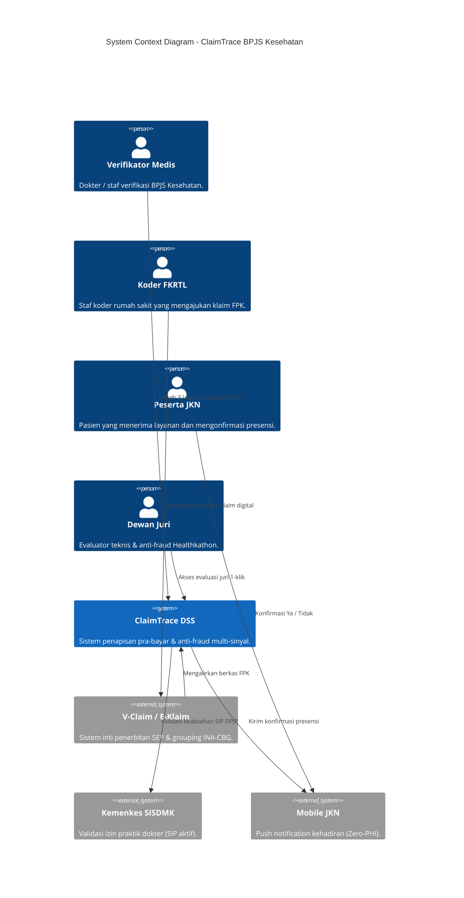

# ClaimTrace — Sistem Penapisan & Efisiensi Risiko Klaim Faskes JKN
### *Decision Support System (DSS) Verifikator Klaim Pra-Bayar Berbasis Triase Multi-Sinyal Independen*
**BPJS Kesehatan Healthkathon 2026 — Tahap Final (Finalist Project)**  
**Kategori Utama:** *Efisiensi Risiko pada Fasilitas Kesehatan (FKRTL)*  
**Fokus Sub-Kategori:** *#6 Phantom Billing & #11 Repeat Billing*  
**Ekspansi Pasca-Healthkathon:** *Deteksi Upcoding INA-CBG, Lapis 4 FRISTA Biometrik Wajah, Berita Acara Digital QR SHA-256, dan Engine Kepatuhan SLA 10 Hari Kerja (Perpres No. 82/2018)*  

**Tim Pengembang: TINEERENSE (MAN 1 Surakarta)**  
- **Khalaf Faith Pradyatama** (*Ketua Tim · Lead Systems Architect & AppSec Engineer*)
- **Gaudiansyah Abiyu Mahya** (*Anggota Tim · AI/ML Engineer & Healthcare Data Analyst*)

> 🏆 **BPJS Kesehatan Healthkathon 2026 Submission Showcase & Panduan Juri:**  
> **[Baca Dossier Lengkap Healthkathon: Healthkathon-README.md](Healthkathon-README.md)**  
> **Live Cockpit:** `http://localhost:3000` | **Dokumentasi API Swagger:** `http://localhost:8000/docs` | **Mode Juri 1-Klik:** Aktif di Halaman Masuk

> [!IMPORTANT]
> **PERNYATAAN RESMI KEPATUHAN DATA PRIBADI & BENCHMARK SINTETIK (UU PDP NO. 27 TAHUN 2022):**  
> Seluruh data yang digunakan dalam repositori dan sistem ClaimTrace ini — meliputi nama pasien, nama dokter/DPJP, nama verifikator/pejabat kedinasan, Nomor Induk Pegawai (NIP), nomor kontak/telepon, alamat, nomor Surat Izin Praktik (SIP), nomor rekam medis, hingga rincian berkas klaim dan nama fasilitas kesehatan — adalah **100% DATA SINTETIK / BENCHMARK FIKTIF**.  
> Tidak ada satupun data pribadi riil (*Personally Identifiable Information / Protected Health Information*) atau data operasional riil dari faskes maupun peserta BPJS Kesehatan yang digunakan atau disimpan dalam repositori ini. Setiap kesamaan nama, gelar, kode, alamat, atau nomor telepon adalah murni rekayasa komputasi dan kebetulan semata.

---

## 1. Tujuan Tunggal & Cara Menyaring Klaim Anomali (Skala 0 - 100)

**Tujuan Tunggal ClaimTrace:** Mengendalikan kecurangan (*anti-fraud*) klaim FKRTL secara **pra-bayar** -- berfokus pada **#6 Phantom Billing**, **#11 Repeat/Split Billing**, dan **Upcoding INA-CBG** -- agar kebocoran Dana Jaminan Sosial (DJS) dicegah sebelum pencairan tanpa melanggar SLA verifikasi 10 hari kerja (Perpres No. 82 Tahun 2018).

Paradigma kerja: **"Satu skor prioritas (0 - 100), tiga lapis bukti faktual independen, keputusan mutlak tetap di tangan verifikator medis (Human-in-the-Loop)."**

```text
                        +---------------------------------------+
                        |    Input Berkas FPK / Klaim FKRTL     |
                        +-------------------+-------------------+
                                            |
        +-----------------------------------+-----------------------------------+
        |                                   |                                   |
        v                                   v                                   v
 [ Sinyal 1: Bobot 50% ]            [ Sinyal 2: Bobot 30% ]            [ Sinyal 3: Bobot 20% ]
   Pola Tagihan & Semantik           Legalitas SIP & OSRM DPJP           Konfirmasi Mobile JKN
 - Lonjakan Klaster >= 3,0x         - Validasi SIP SATUSEHAT SDMK      - Push Biner Ya / Tidak
 - Repeat Billing <= 30 hari        - Geovelocity OSRM > 120 km/jam    - Zero-PHI (UU PDP 27/2022)
 - ChromaDB Similarity >= 90%       - Beban > 40 pasien/hari           - Absen Respon -> Kuning
 - Pengecualian PRB <= 30 hari      - Hard Trigger: SIP Expired
        |                                   |                                   |
        +-----------------------------------+-----------------------------------+
                                            |
                                            v
                        +---------------------------------------+
                        |   Fusi Deterministik (Skala 0 - 100)  |
                        |   S = 0,50*S1 + 0,30*S2 + 0,20*S3     |
                        +-------------------+-------------------+
                                            |
        +-----------------------------------+-----------------------------------+
        |                                   |                                   |
        v                                   v                                   v
 [ JALUR HIJAU ]                    [ JALUR KUNING ]                    [ JALUR MERAH ]
  (0,0 - 49,9)                        (50,0 - 74,9)                      (75,0 - 100,0)
 Wajar / Fast-Track             Klarifikasi Berkas / Unsynced         Hard Trigger SIP Expired
   (< 24 Jam)                    (Tidak langsung vonis fraud)         Hold Pra-Bayar & BAKB SHA-256
```

---

## 2. Empat Lapis Inti, Ambang Saring, & Gudang Data Analitik

1. **Sinyal 1 -- Pola Tagihan, Semantik NLP, & Outlier AI (Bobot 50%):**
   Mendeteksi lonjakan klaster (`rasio_lonjakan_baseline >= 3,0x` tanpa izin baksos resmi), penagihan ulang episode identik (#11 Repeat Billing `<= 30` hari atau klaim ganda hari sama lintas/intra RS), upcoding Level I ke III, serta duplikasi narasi resume medis via ChromaDB (`all-MiniLM-L6-v2` cosine similarity `>= 90%`) dan Isolation Forest On-Premise (`< 15 ms` core). Obat kronis Program Rujuk Balik (PRB `<= 30` hari) dan terapi kronis sah seperti Hemodialisis Z49.1 dilindungi oleh **5 aturan deterministik FairGuard** (Permenkes No. 3/2023 Pasal 37, **0,0% FPR pada 512 kasus hard-negative**).
2. **Sinyal 2 -- Legalitas SIP DPJP & Geovelocity OSRM (Bobot 30%):**
   Memeriksa masa berlaku SIP DPJP pada tanggal layanan (`EXPIRED` langsung memicu Hard Trigger ke Jalur Merah minimal skor `75,0`, sedangkan `UNSYNCED` dialihkan ke Jalur Kuning agar tidak menjadi *false positive* fraud), memeriksa beban harian DPJP (`> 40` pasien/hari), dan menghitung kelayakan rute darat via OSRM (`> 120 km/jam` antar RS dalam < 45 menit).
3. **Sinyal 3 -- Konfirmasi Biner Peserta Mobile JKN (Bobot 20%):**
   Mengirim konfirmasi kehadiran Ya/Tidak berprinsip *Zero-PHI* (tanpa mengekspos kode diagnosis ICD-10 atau obat) sesuai Pasal 34 UU PDP No. 27/2022. Ketiadaan respons peserta tidak memvonis Jalur Merah.
4. **Lapis 4 -- Validasi RME-TTE BSrE & Biometrik Wajah FRISTA:**
   Memvalidasi keutuhan dokumen RME-TTE serta presensi biometrik FRISTA sebagai bukti pendukung sebelum penindakan klaim Jalur Merah & penerbitan BAHV/BAKB.
5. **Data Empiris Gudang Data Analitik On-Premise (Total 6.264.346 Baris):**
   - `bpjs_fkrtl_all`: **1.699.219 klaim FKRTL** dari **2.091 FKRTL** di **496 Kab/Kota (38 Provinsi)** senilai **Rp 1,536 Triliun** (rata-rata `4.643` klaim/hari, puncak `7.870`/hari).
   - `bpjs_kepesertaan_all`: **2.590.751 baris** master kepesertaan (1.065.281 keluarga).
   - `bpjs_diagnosissekunder_all`: **1.967.670 baris** diagnosis sekunder + `6.706` referensi ICD-10.
   - Anomali Empiris Terindeks: **1.631 klaim** koreksi tarif langsung (**Rp 2,07 Miliar**) dan **4.876 pasang** klaim ganda hari sama (`2.584` lintas RS Rp `19,26 Miliar` + `2.292` intra RS Rp `13,33 Miliar` = total eksposur **Rp 32,59 Miliar**).

---

## 3. Alur Kerja 4 Pilar Verifikasi & Model Arsitektur C4

Antarmuka ClaimTrace disusun berlandaskan siklus hidup verifikasi klaim sekuensial 4-Pilar (*Sequential Adjudication Pipeline*) guna menjamin kepatuhan terhadap SLA 10 Hari Kerja (Ps. 76 Perpres No. 82/2018):

1. **Pilar 1: Antrean & Berkas Klaim (`1. Antrean & Berkas Klaim`):**  
   Triase otomatis berkas FPK masuk ke 3 lajur kepatuhan (Hijau `<24 jam`, Kuning `5 hari kerja`, Merah `tahan pra-bayar`).
2. **Pilar 2: Telaah & Dokumen Medis (`2. Telaah & Dokumen Medis`):**  
   Audit komparatif 3 lapis: resume medis elektronik (RME), legalitas SIP & batas fisik DPJP, geovelocity OSRM, dan telemetri kehadiran Mobile JKN.
3. **Pilar 3: Konsol Putusan & BAKB (`3. Konsol Putusan & BAKB`):**  
   Formulasi amar putusan human-in-the-loop (Setujui / Koreksi / Tunda), penerbitan Berita Acara Kelengkapan Berkas (BAKB) digital QR SHA-256, dan penanganan sengketa TKMKB.
4. **Pilar 4: Pengawasan Faskes & DPJP (`4. Faskes & DPJP`):**  
   Surveilans longitudinal profil risiko faskes (*Facility Risk Index* - FRI), pemantauan dokter anomali, dan visualisasi sindikat klaim lintas rumah sakit.

### Diagram Arsitektur C4 Context



---

## 4. Panduan Menjalankan Sistem di Lingkungan Lokal

### Prasyarat Sistem
- **Python**: Versi 3.10, 3.11, 3.12, atau 3.14
- **Node.js**: Versi 18+ atau 20+
- **Browser**: Google Chrome, Edge, atau Firefox

### Menjalankan Seluruh Layanan (Rekomendasi Cepat)
Gunakan skrip startup otomatis untuk menjalankan backend dan frontend sekaligus:
```bash
./start_all.sh
```
Atau di Windows Command Prompt:
```cmd
start_all.bat
```

### Menjalankan Layanan Secara Terpisah

#### 1. Backend API (FastAPI)
```bash
cd backend
python3 -m uvicorn app.main:app --host 0.0.0.0 --port 8000 --reload
```
- **REST API Endpoint:** `http://localhost:8000/`
- **Dokumentasi Swagger / OpenAPI:** `http://localhost:8000/docs`
- **Daftar Klaim & Status:** `http://localhost:8000/api/v1/claims`
- **Berita Acara Digital (BAKB):** `http://localhost:8000/api/v1/claims/{claim_id}/official-bakb`
- **Throughput SIMD Benchmark:** `http://localhost:8000/api/v1/system/national-scale-benchmark`

#### 2. Frontend Cockpit (React 18 + Vite)
```bash
cd app
npm run dev -- --host 0.0.0.0 --port 3000
```
- **Aplikasi Web:** Buka browser pada **`http://localhost:3000`**
- **PWA Offline Service Worker:** Terpasang otomatis via `sw.js` untuk ketahanan audit lapangan Wasrik tanpa koneksi internet.
- **Akses Cepat Dewan Juri (1-Click Evaluation Mode):**
  Untuk mempermudah pengujian langsung oleh dewan juri tanpa hambatan OTP email atau captcha, tersedia tombol hijau **`[ 🛡️ Masuk Langsung Administrator (Mode Juri) ]`** di bagian bawah form login yang langsung membuka sesi Administrator dalam 1 kali klik.
- **Kredensial Login Verifikator Resmi (Fail-Closed 4-Field + 3-Lapis Google reCAPTCHA + MFA):**
  - Username / NIP: `siti.rahma` / `198704202011012001` (dr. Siti Rahma, Sp.PK -- Verifikator Medis Senior)
  - Email: `siti.rahma@bpjs-kesehatan.go.id` | Kata Sandi: `Password123!` | PIN MFA: `123456`
  - Alternatif NIP: `199208152015031002` (`admin.fraud` / `admin.fraud@bpjs-kesehatan.go.id` -- Budi Santoso, S.Kom, M.TI)
  - Pengaman CAPTCHA: 3 lapisan Google reCAPTCHA aktif pada antarmuka Sign-In (v2 Checkbox + v3 Score + Enterprise; mode pengembangan mendukung header `test-token` bila `RECAPTCHA_ENFORCE_ALL_LAYERS=false`).

---

## 5. Pengujian Kualitas & Validasi Otomatis

Pengujian otomatis (`backend/tests/` dan `tests_e2e/`) memvalidasi keamanan kriptografis, kalkulasi SLA hari kerja, integritas rantai audit SHA-256, rule anti-fraud & FairGuard Z49.1, Zero-PHI UU PDP, dan algoritma penapisan `0,50*S1 + 0,30*S2 + 0,20*S3`:
```bash
python3 -m pytest backend/tests/ -q
python3 -m pytest tests_e2e/ -q
python3 scripts/verify_claimtrace_stack.py
```
**Hasil Uji Kualitas & Benchmark Terverifikasi:**
- **Backend & E2E Test Suite:** **300 of 300 Backend Tests Passed** (`backend/tests/`) + **112 of 112 E2E Tests Passed** (`tests_e2e/`) = **412 Total Tests Passed (100% Green)** meliputi **197 Endpoint FastAPI Aktif**.
- **Internal Stack Smoke Check:** **16/16 endpoint verifikasi kritis lulus** via `scripts/verify_claimtrace_stack.py`.
- **Uji Integritas Rantai Audit Tamper-Evident:** Lulus 100% mendeteksi pemalsuan payload, manipulasi `prev_hash`, dan pembongkaran segel kriptografis.
- **Benchmark HKEval (`n=3.002` klaim, 2,0% prevalensi, 5/5 Checklist REFORMS Lolos):**
  - **Precision@50 = 86,0%** (43,0x Lift; `+30,0%` poin dibanding aturan baku, paired `p = 0,0012`)
  - **Rupiah Recall@100 = 96,8%** (`58/60` kasus fraud pada Top-100 antrean)
  - **False Positive Rate (Hard-Negative) = 0,0%** (`0/512` klaim sah seperti Hemodialisis `Z49.1` & Thalassemia terblokir keliru)
  - **Blind Review Eksternal = 95,0%** (`19/20` anomali RS uji terdeteksi tanpa riwayat historis)
  - **Hold-Out Transparan:** pola belum terlihat Unbundling `66,7%` (`2/3`) dan Prolonged LOS `0,0%` (`0/11`) dipetakan sebagai fokus kalibrasi aturan Tahap 1 Pilot 12 RS.

Pengujian Otomatis End-to-End Browser:
```bash
cd app
npm run test:e2e
```
Hasil: Seluruh skenario operasional (Executive Hub, Triase 3 Jalur, Cek Dokumen RS, Peringkat Risiko Faskes, Database Viewer SQL, DPJP Intelligence & Geovelocity, Audit Ledger SHA-256, dan Mobile JKN Telemetry) lulus 100% tanpa kesalahan (*0 critical page errors*).

Stress Test Throughput SIMD Kolumnar:
```bash
curl -X POST "http://127.0.0.1:8000/api/v1/system/national-scale-benchmark?claim_count=500000"
```
Hasil: Pemrosesan 500.000 transaksi klaim FKRTL selesai dengan throughput di atas **2.500.000 hingga 4.100.000 baris/detik** (2.091 FKRTL) dan latensi inferensi API live **11,90 ms** (`< 15 ms` core on-premise).

Ketahanan Lapangan & Aksesibilitas (PWA & A11y):
- **PWA Service Worker:** Registrasi otomatis `sw.js` dengan strategi network-first untuk API dan cache-first untuk aset statis mendukung verifikator Wasrik di daerah terpencil.
- **Aksesibilitas Modal:** 100% modal (BAKB Adjudication, Detection & SOAR, Receipt, Threat Defense Matrix, Compliance, Report, Campaign, dan Bulk Tag) dilengkapi penanganan tombol Escape dan penutupan klik luar (backdrop click).

Kompilasi produksi frontend:
```bash
cd app
npm run build
```
Hasil: Kompilasi Vite berhasil 100% tanpa kesalahan (*0 errors*) across 3.008 modul.

---

## 6. Kepatuhan Regulasi & Standar Keamanan

- **Perpres No. 82 Tahun 2018 Pasal 74 & 76:** Menjaga SLA pembayaran klaim maksimal 15 hari kalender dan SLA verifikasi 10 hari kerja.
- **Permenkes No. 26 Tahun 2021:** Pedoman pencegahan dan penanganan kecurangan (*fraud*) dalam program Jaminan Kesehatan Nasional.
- **Permenkes No. 3 Tahun 2023 Pasal 37:** Standar tarif pelayanan kesehatan dan perlindungan klaim obat Program Rujuk Balik (PRB).
- **UU No. 27 Tahun 2022 (UU PDP):** Prinsip minimasi data, *Zero-PHI Redaction*, dan penyamaran kriptografis pada seluruh data medis peserta.
- **ISO/IEC 27001 & NIST CSF 2.0:** Pengamanan API melalui validasi input SQL Guard, prompt firewall, dan rate limiting adaptif.

---

## 7. Pernyataan Integritas Data
Dikembangkan khusus untuk kompetisi **BPJS Kesehatan Healthkathon 2026**.  
Seluruh data identitas peserta, dokter, fasilitas kesehatan, nomor kartu BPJS/KIS, NIK, dan nomor rekam medis yang digunakan dalam demonstrasi prototipe ini adalah **data sintetis/fiktif** yang dihasilkan secara terkalibrasi guna mematuhi prinsip kerahasiaan medis dan perlindungan data pribadi.
