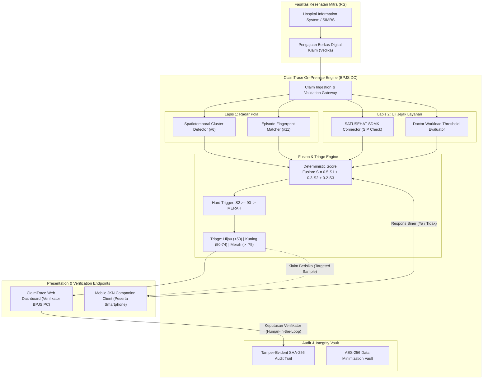

# SYSTEM ARCHITECTURE & DATA SPECIFICATION (ARCHITECTURE.md)
## Project: ClaimTrace Pre-Payment Decision Support System
**Target Environment:** BPJS Kesehatan On-Premise Data Center & Secure Client Ports  
**Security Standard:** UU PDP No. 27/2022, AES-256 at-rest, TLS 1.3 in-transit  

---

## 1. High-Level Architecture Topology



---

## 2. Data Models & JSON Contracts

### 2.1. Ingested Claim Payload (`ClaimRecord`)
```json
{
  "claim_id": "CLM-2026-10-085",
  "sep_number": "0132R0011026V000085",
  "hospital_code": "0132R001",
  "hospital_name": "RS Khusus Mitra Husada",
  "patient_pseudonym_id": "PST-77218902",
  "service_date": "2026-10-14",
  "admission_date": "2026-10-14",
  "discharge_date": "2026-10-14",
  "inacbg_code": "Z-3-12-0",
  "inacbg_tariff": 180000,
  "primary_icd10": "M62.8",
  "procedures_icd9cm": ["93.11", "93.39"],
  "dpjp_id": "DOC-9921",
  "dpjp_name": "dr. Hendra, Sp.KFR",
  "batch_event_tag": "BAKSOS_MASSAL_OKT26"
}
```

### 2.2. Scoring Breakdown Contract (`TriageEvaluation`)
```json
{
  "claim_id": "CLM-2026-10-085",
  "timestamp": "2026-10-22T10:45:12.891Z",
  "layer_1": {
    "score": 85.0,
    "weight": 0.5,
    "weighted_score": 42.5,
    "volume_spike_ratio": 8.5,
    "is_repeat_episode": false,
    "cluster_flag": "MASS_CHARITY_ANOMALY"
  },
  "layer_2": {
    "score": 95.0,
    "weight": 0.3,
    "weighted_score": 28.5,
    "satusehat_sip_status": "EXPIRED",
    "faskes_active_assignment": false,
    "daily_doctor_volume": 85,
    "hard_trigger_tripped": true
  },
  "layer_3": {
    "score": 80.0,
    "weight": 0.2,
    "weighted_score": 16.0,
    "sample_size": 10,
    "confirmed_count": 2,
    "denied_count": 8,
    "sample_status": "HIGH_DENIAL_RATIO"
  },
  "total_score": 87.0,
  "triage_lane": "RED",
  "verdict_recommendation": "SUSPEND_AND_REQUEST_CLARIFICATION"
}
```

### 2.3. Mobile JKN Verification Message (`PresenceVerificationRequest`)
```json
{
  "verification_id": "VERIF-REQ-90128",
  "patient_pseudonym_id": "PST-77218902",
  "masked_service_info": {
    "hospital_name": "RS Khusus Mitra Husada",
    "service_date": "14 Oktober 2026",
    "procedure_group_name": "Prosedur Fisioterapi / Rehabilitasi Medis",
    "dpjp_name": "dr. Hendra, Sp.KFR"
  },
  "prompt_text": "Apakah benar Anda hadir secara langsung dan menerima tindakan medis tersebut pada tanggal dan faskes di atas?",
  "binary_options": ["YA_SAYA_HADIR", "TIDAK_PERNAH"],
  "privacy_note": "Konfirmasi ini murni mencatat presensi (biner) tanpa mengungkap diagnosis medis sensitif sesuai UU PDP No. 27/2022."
}
```

### 2.4. Tamper-Evident Audit Record (`AuditTrailLog`)
```json
{
  "audit_id": "AUDIT-2026-10-8912",
  "claim_id": "CLM-2026-10-085",
  "officer_id": "VERIF-SKR-0412",
  "officer_name": "dr. Siti Rahma",
  "officer_role": "VERIFIKATOR_KLAIM_FKRTL",
  "action_taken": "TUNDA_BERITA_ACARA_DAN_KLARIFIKASI",
  "legal_ground": "Pasal 76 ayat (2) Perpres No. 82 Tahun 2018",
  "calculated_score": 87.0,
  "reasons": [
    "Lonjakan klaim 8.5x dari baseline faskes",
    "SIP DPJP tidak aktif di SATUSEHAT SDMK pada tgl layanan",
    "8 dari 10 peserta sampel menyangkal menerima layanan"
  ],
  "timestamp": "2026-10-22T10:46:01.120Z",
  "sha256_hash": "9e8a7c2b512f43a91e0892cfa71290bb34102c98d7831fa281"
}
```

---

## 3. Real-Time Synchronization Bus (Reactive Bridge)

Untuk demo prototipe dan lingkungan operasional, koneksi antara **Mobile JKN Client** dan **Verifikator Dashboard** menggunakan event bus berbasis WebSocket / Server-Sent Events (SSE):

1. **State Dispatcher:** Ketika pengguna di simulasi smartphone mengklik tombol `[DITOLAK / Tidak Pernah]`:
   - Event `PATIENT_CONFIRMATION_SUBMITTED` dikirimkan dengan payload `{ claim_id: "CLM-085", answer: "denied" }`.
2. **Dynamic Recalculation:**
   - Mesin backend seketika menghitung ulang nilai $S_3$ dari $80.0 \to 92.0$.
   - Fusi skor terbarui secara otomatis:
     $$S = (0.5 \times 85) + (0.3 \times 95) + (0.2 \times 92) = 42.5 + 28.5 + 18.4 = \mathbf{89.4}$$
3. **Reactive UI Update:**
   - Dashboard Verifikator di sebelah kanan menampilkan efek visual pulsa hijau/merah pada kartu Lapis 3, mengindikasikan bahwa sinyal empiris pasien baru saja diterima dari lapangan dalam hitungan milidetik.
