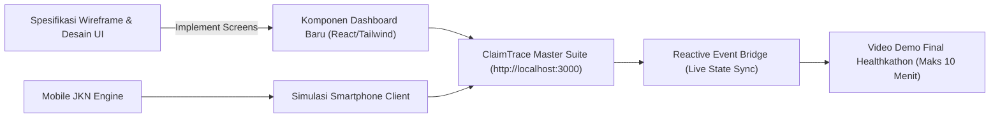

# INTEGRATION & DEPLOYMENT ROADMAP (INTEGRATION_PLAN.md)
## Project: ClaimTrace Unified Suite (Healthkathon 2026)
**Objective:** Menggabungkan Frontend Dashboard Verifikator dengan Engine Mobile JKN Developer Edition  

---

## 1. Overview Alur Kerja Penggabungan (Integration Flow)



---

## 2. Langkah-Langkah Integrasi Langkah demi Langkah (Step-by-Step)

### Tahap 1: Implementasi Komponen Berdasarkan Spesifikasi UI
1. Buka referensi tata letak antarmuka ClaimTrace JKN.
2. Gunakan spesifikasi tata letak dan modul antarmuka:
   - **Layar 1:** `claimtrace-triage-overview` (Dashboard Antrean Utama)
   - **Layar 2:** `claimtrace-case-investigation` (Matriks Bukti 3 Lapis)
   - **Layar 3:** `claimtrace-graph-visualizer` (Visualisasi Graf Jejaring Anomali)
   - **Layar 4:** `claimtrace-decision-console` (Konsol Keputusan & Stempel SHA-256)
3. Implementasikan kode JSX / Tailwind sesuai token pada [`UI_DESIGN_SYSTEM_SPEC.md`](UI_DESIGN_SYSTEM_SPEC.md).

### Tahap 2: Penempatan Komponen ke Kode Proyek
1. Simpan komponen antarmuka ke dalam direktori:
   [`app/src/components/Dashboard/`](../app/src/components/Dashboard/)
2. Komponen yang telah disiapkan:
   - `TriageOverview.jsx`
   - `CaseInvestigationMatrix.jsx`
   - `NetworkGraphViewer.jsx`
   - `DecisionConsole.jsx`

### Tahap 3: Penyambungan State Management (Reactive Bridge)
Sambungkan state antara dashboard verifikator dan smartphone simulator di [`src/App.jsx`](../app/src/App.jsx):
- Handler `handlePatientAnswer('denied')` dari Mobile JKN meneruskan nilai ke prop dashboard:
  ```jsx
  <CaseInvestigationMatrix 
    s1={85}
    s2={95}
    s3={lapis3Score} // bernilai dinamis (80 -> 92)
    patientResponse={patientResponse}
    onVerificatorDecision={handleDecision}
  />
  ```

### Tahap 4: Pengujian & Final Polish Build
Jalankan verifikasi build di terminal:
```bash
cd app
npm run build
```
Pastikan kompilasi sukses dengan status `0 errors` dan buka `http://localhost:3000`.

---

## 3. Panduan Perekaman Video Demo 10 Menit untuk YouTube (Private)

Sesuai dengan ketentuan resmi di `Panduan Project Final Healthkathon 2026.pdf` (Slide 3):

| Menit ke- | Isi Paparan Video | Layar yang Ditampilkan |
| :---: | :--- | :--- |
| **00:00 – 00:30** | Perkenalan Tim TINEERENSE (Khalaf Faith Pradyatama & Gaudiansyah Abiyu Mahya - MAN 1 Surakarta). | Slide Perkenalan Tim (Kamera aktif). |
| **00:30 – 02:00** | Judul Ide, Deskripsi, Masalah Nyata (Kerugian Rp 34M & 75,3% klaim fiktif fisioterapi rilis KPK/Kemenkes). | Slide Latar Belakang & Masalah. |
| **02:00 – 03:30** | Alur Proses Aplikasi: Alur 3 Lapis (Radar Pola, Uji Jejak SATUSEHAT SDMK, Konfirmasi Mobile JKN). | Diagram Arsitektur Sistem. |
| **03:30 – 07:00** | **DEMO LANGSUNG APLIKASI (Live Demo di `http://localhost:3000`):**<br>1. Tunjukkan tampilan **Split-Sync**.<br>2. Tunjukkan antrean klaim di Dashboard BPJS.<br>3. Buka kasus RS Mitra Husada (Skor 87 - Merah).<br>4. Perlihatkan simulasi Mobile JKN saat notifikasi presensi masuk.<br>5. Klik tombol `[Tidak Pernah Hadir]` di HP, lalu tunjukkan skor di dashboard BPJS seketika bereaksi live!<br>6. Klik tombol `[Tunda Berita Acara & Minta Klarifikasi Faskes]` dan perlihatkan stempel SHA-256 tamper-evident. | **Screen Share Web App `http://localhost:3000`** (Mode Split-Sync). |
| **07:00 – 08:30** | Penjelasan Keunggulan Fitur, Kepatuhan UU PDP No. 27/2022 (Data Minimization), dan Human-in-the-Loop. | Slide Fitur & Privasi Data. |
| **08:30 – 10:00** | Rencana Implementasi On-Premise BPJS & Penutup. | Slide Rencana & Penutup. |
